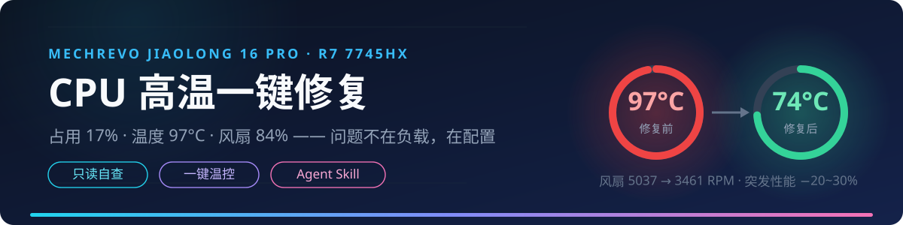

<div align="center">
  

# 机械革命蛟龙16 Pro · CPU 高温一键修复

**占用 17% 却 97°C · 风扇 84% 狂转 —— 三个脚本 + 一个 Agent Skill 解决**


**[快速开始](#快速开始) · [根因解析](#根因三层叠加) · [自查判定](#先自查再动手) · [Agent Skill](#让-ai-agent-替你排查) · [FAQ](#faq)**

</div>

---

## 这是不是你的问题？

在蛟龙游戏控制中心里看到这样的画面：

| 指标 | 读数 | 直觉 |
|---|---|---|
| CPU 温度 | **97~98°C** | 顶在温度墙上 |
| CPU 占用 | **17~21%** | 明明很闲 |
| 风扇 | **5037 RPM（84%）** | 已经全力了 |
| 温度曲线 | 锯齿状尖刺不断冲高 | 反复爆发 |

如果对上了，往下看。**问题不在负载，在配置。**

## 根因：三层叠加

| # | 根因 | 机制 |
|---|------|------|
| 1 | **电源计划被控制中心改写** | 切到"游戏模式"时，交流电下的「最小处理器状态」被写成 **80%**——只要插电，8 个核心任何时刻都不允许降到低频，空闲也钉在 3.6GHz 基础频率上烧 30~50W |
| 2 | **AMD 加速算法"贴墙跑"** | 只要有任务突发（测试、编译、后台服务），加速算法主动把频率推到 4.4~5.1GHz，直到撞上 ~99°C 热学上限才收敛。**这是设计行为**：7745HX 的 Tjmax 是 100°C，超了会自动降频自保，不会烧坏 |
| 3 | **温度曲线的尖刺** | 占用 17% 是平均值，掩盖了突发。每次突发放一大股热，两层叠加 = 温度永远贴着墙 |

另外一个彩蛋发现：不少批次的机器 **ACPI 温度传感器（TZ01）是锁存的假读数**——几个小时恒定 98.9°C 一动不动，关了加速也不变。判断温度请以控制中心显示为准（它走自己的 SMU 通道）。

## 快速开始

```bat
git clone https://github.com/Nina-noSchool/mechrevo-16pro-cpu-temp-fix.git
cd mechrevo-16pro-cpu-temp-fix
```

或者到 **[Releases](https://github.com/Nina-noSchool/mechrevo-16pro-cpu-temp-fix/releases/latest)** 下载稳定版。然后：

1. 双击 **`Check_Thermal.bat`**（只读不改任何东西，UAC 点"是"）→ 看 `VERDICT` 判定
2. 按判定双击对应脚本 → 窗口里显示注册表读回的实际值，**亲眼确认生效**

| 脚本 | 作用 | 什么时候用 |
|------|------|-----------|
| 🔍 `Check_Thermal.bat` | 只读自查：电源方案 → 加速模式/最小状态/实时频率 → 温度传感器卡滞检测 → 自动判定 | **第一步永远是它** |
| 🧊 `Night_Cooling.bat` | 关闭涡轮加速 + 频率地板 5% → 温度降到 60~75°C，风扇安静 | 跑测试、挂机、过夜 |
| ⚡ `Restore_CPU_Boost.bat` | 恢复满血加速 | 打游戏、重负载前 |
| 🖥️ `ThermalDoctor.bat` | 一体化控制台：菜单整合诊断 / 切换 / 实时监控 | 想一个工具全搞定 |

### 进阶：ThermalDoctor 一体化控制台

不想在脚本间来回切换？双击 **`ThermalDoctor.bat`**（UAC 点"是"）：

```
================================================
   Jiaolong Thermal Doctor  v1.1
================================================
   [1] Diagnose now (read-only)
   [2] Switch to COOL mode  (boost off, quiet)
   [3] Switch to BOOST mode (full speed, gaming)
   [4] Live monitor (Ctrl+C to stop)
   [5] About / how to read results
   [0] Exit
```

进阶用户和 Agent 可以带参数直接调用，适合写进自动化流程：

```powershell
powershell -NoProfile -ExecutionPolicy Bypass -File ThermalDoctor.ps1 -Action diagnose
# -Action: diagnose | cool | boost | monitor
```

每次修改设置后都会自动回读注册表实际值确认生效，不靠"应该没问题"。

## 先自查再动手

`Check_Thermal.bat` 会把你的机器归入下面四种情况之一：

| 加速模式 | 最小状态 | 判定 | 建议 |
|---------|---------|------|------|
| 1 / 2（开） | ≥ 20 | 经典 OEM 配置问题：地板被拉高 + 加速贴墙 | 两个都要修 → `Night_Cooling` |
| 1 / 2（开） | ≤ 5 | 加速贴墙跑（AMD 设计行为） | 想凉快就 `Night_Cooling` |
| 0（关） | ≥ 20 | 只有地板问题：核心永远降不了频 | `Night_Cooling` 恢复地板 |
| 0（关） | ≤ 5 | 电源配置没问题 | 高温 = 真负载（任务管理器）或散热问题（清灰/换硅脂） |

## 修复前后实测

同一台蛟龙16 Pro（R7 7745HX + RTX 4070），同一晚：

| 指标 | 修复前 | 修复后 |
|------|--------|--------|
| CPU 温度 | 97~98°C（贴墙） | **74°C** |
| 风扇 | 5037 RPM（84%） | 3461 RPM（58%） |
| 频率行为 | 4.4~5.1GHz 冲刺撞墙循环 | 稳定 3.56GHz（基础频率封顶） |
| 突发性能 | 100% | −20~30%（跑测试无感，游戏记得切回来） |

## 让 AI Agent 替你排查

本仓库自带 Agent Skill（通用 SKILL.md 格式），装好后你的 AI 助手遇到"CPU 怎么这么烫"会自动走完 **诊断 → 判定 → 征求同意 → 修复 → 复读验证** 全流程：

| Agent | 安装位置 |
|-------|---------|
| ZCode | `~/.zcode/skills/thermal-selfcheck/` |
| Claude Code | `~/.claude/skills/thermal-selfcheck/` |

复制仓库里的 `skills/thermal-selfcheck` 文件夹过去即可。Skill 里编码了完整诊断命令、四象限判定表、性能取舍说明，以及一批实测踩坑记录（包括网上教程普遍把 PERFBOOSTMODE 的 GUID 写错这件事）。

## FAQ

**Q: 97°C 会不会烧坏 CPU？**
不会。Tjmax 100°C 以内都是设计工作范围，超温 CPU 会自动降频保护。要解决的只是高温噪音和无谓的功耗。

**Q: 为什么切了"办公模式"还是 92°C？**
办公模式只压了风扇曲线和功耗墙，涡轮加速还是开着的。想要彻底凉快用 `Night_Cooling.bat`。

**Q: 为什么脚本提示是英文？**
故意的。中文 Windows 的 cmd 用 GBK 解析批处理，含中文/UTF-8 的 .bat 会被撕成乱码命令（本仓库开发过程中实测踩了两次坑）。纯 ASCII 是唯一在所有语言系统上都稳的方案。

**Q: 为什么我的温度读数一直是 98.9°C 不动？**
你遇到了和本仓库作者一样的锁存传感器。`Check_Thermal.bat` 会连读 5 次检测这种情况并提示你。真实温度看控制中心。

**Q: 控制中心会不会改回去？**
会。每次切换它的性能模式（游戏/办公/狂飙/自定义）都可能重写这些设置。脚本不是疫苗，是解药——切完模式发现状态不对，双击对应脚本一秒复原。

## 适用范围与实测环境

| 项目 | 环境 |
|------|------|
| 机型 | 机械革命蛟龙16 Pro |
| CPU | AMD Ryzen 7 7745HX（8C16T，基频 3.6GHz，Tjmax 100°C） |
| GPU | NVIDIA GeForce RTX 4070 Laptop |
| 系统 | Windows 11（build 26200） |

原理是纯 Windows 电源管理（powercfg / 注册表），大概率同样适用于其他被 OEM 控制中心改坏电源计划的同方系机型（机械革命 / 七彩虹 / 神舟等）。不同批次 BIOS/控制中心版本行为可能不同——**先跑 `Check_Thermal.bat` 看判定，别盲修**。

若自查后你的情况不在四种之内，欢迎提 Issue，附上 `Check_Thermal.bat` 的完整输出。

## License

[MIT](LICENSE) © Nina-noSchool

<div align="center">

**如果帮你把温度压下来了，点个 Star ⭐ 让更多蛟龙16 Pro 的兄弟看到**

</div>
